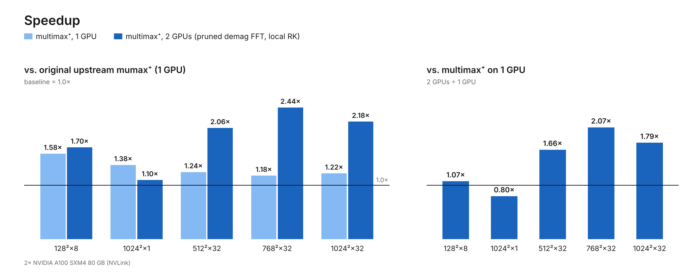
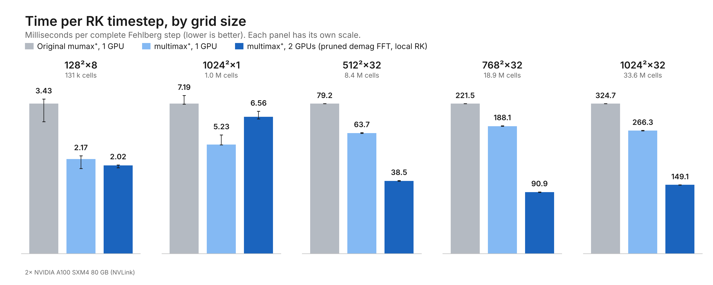
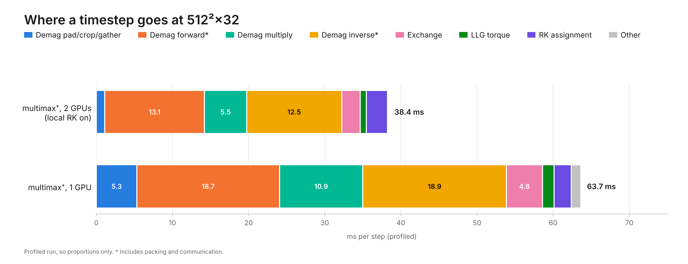

# Installing multimaxplus

Multimaxplus is an experimental fork of mumax⁺. Build this repository from source
using the instructions below. Upstream `pip install mumaxplus` wheels do not
contain this fork's changes.

The current build requires **Linux, CUDA, cuFFTMp, NVSHMEM, and Open MPI**, even
for normal single-GPU execution. Multi-GPU execution is enabled separately with
`--multigpu`; normal execution remains the default.

# Performance




## Requirements

- A Linux system supported by your NVIDIA HPC SDK release.
- NVIDIA GPUs and a driver compatible with the selected CUDA/cuFFTMp release.
- A C++17 compiler, GNU Fortran for SDK installation, and CMake >= 3.24.
- Python >= 3.11, with development headers and virtual-environment support.
- Matching CUDA, cuFFTMp, NVSHMEM, and CUDA-aware Open MPI libraries.

Our development configuration uses Ubuntu 24.04 on x86_64, Python 3.12, NVIDIA
HPC SDK 26.5 with CUDA 13.2, and two A100 SXM4 80GB GPUs connected over NVLink.
The commands below use that software combination as an example; adjust versions
and paths to match your installation.

Check NVIDIA's [cuFFTMp hardware and software requirements](https://docs.nvidia.com/cuda/cufftmp/usage/requirements.html)
and the release notes for your SDK and driver. General CUDA compatibility alone
does not establish cuFFTMp compatibility.

## 1. Install system dependencies

For Ubuntu 24.04:

```bash
sudo apt-get update
sudo apt-get install -y --no-install-recommends \
    build-essential gfortran pkg-config git ca-certificates \
    python3.12 python3.12-dev python3.12-venv \
    libnuma1 libnl-3-200 libnl-route-3-200 libibverbs1 ibverbs-providers
```

Use the equivalent packages for another supported distribution.

## 2. Install the NVIDIA HPC SDK

Download the appropriate installer from the
[NVIDIA HPC SDK 26.5 download page](https://developer.nvidia.com/hpc-sdk/releases/26.5)
and follow the [NVIDIA installation guide](https://docs.nvidia.com/hpc-sdk/installation-guide/index.html).
For the example below, select the x86_64 package containing CUDA 13.2.

Use the matching CUDA, MPI, cuFFTMp, and NVSHMEM components from that SDK.
The example SDK location is:

```text
/opt/nvidia/hpc_sdk/Linux_x86_64/26.5
```

You may install the SDK elsewhere; change `SDK` in step 4 accordingly.
The NVIDIA driver must also be installed on the machine that runs simulations.

## 3. Clone this fork and create a Python environment

Run this from the directory where you want the checkout:

```bash
git clone --recursive https://github.com/fossil-fishhhooks/multimaxplus.git
cd multimaxplus
git submodule update --init --recursive

python3.12 -m venv .venv
source .venv/bin/activate

python -m pip install --upgrade pip setuptools wheel 'cmake>=3.24' ninja
python -m pip install 'numpy>=2' scipy matplotlib 'pyovf>=0.2.15' tqdm pytest pandas
```

The Python import name remains **`mumaxplus`**.

## 4. Configure the environment

From the checkout root, with the virtual environment activated:

```bash
export SDK=/opt/nvidia/hpc_sdk/Linux_x86_64/26.5
export NVSHMEM_ROOT="$SDK/comm_libs/13.2/nvshmem"
export PATH="$SDK/comm_libs/mpi/bin:$SDK/cuda/13.2/bin:$SDK/compilers/bin:$PATH"
export LD_LIBRARY_PATH="$NVSHMEM_ROOT/lib:$SDK/math_libs/13.2/lib64:$SDK/math_libs/13.2/lib64/cufftmp:$SDK/cuda/13.2/lib64:$SDK/comm_libs/mpi/lib${LD_LIBRARY_PATH:+:$LD_LIBRARY_PATH}"

export MULTIMAX_ROOT="$PWD"
export MUMAXPLUS_FP_PRECISION=SINGLE
export PYTHONPATH="$MULTIMAX_ROOT/build/src/bindings:$MULTIMAX_ROOT${PYTHONPATH:+:$PYTHONPATH}"
```

Repeat the environment setup in each new shell, or save it in your preferred
shell configuration. Activating `.venv` alone does not configure MPI or the SDK
shared-library paths. Run the exports from the checkout root so `MULTIMAX_ROOT`
points at the correct directory.

Check the selected tools and the GPUs:

```bash
nvcc --version
mpicxx --version
mpirun --version
nvidia-smi
nvidia-smi topo -m
nvidia-smi topo -p2p r
```

`nvidia-smi` reports driver CUDA compatibility; `nvcc --version` identifies the
compiler selected by your environment.

## 5. Build the Python extension

From the checkout root:

```bash
cmake -S . -B build -G Ninja \
    -DCMAKE_BUILD_TYPE=Release \
    -DCMAKE_CUDA_ARCHITECTURES=native \
    -DCMAKE_CXX_COMPILER=/usr/bin/g++ \
    -DCMAKE_CUDA_COMPILER="$SDK/cuda/13.2/bin/nvcc" \
    -DCUDAToolkit_ROOT="$SDK/cuda/13.2" \
    -DMPI_CXX_COMPILER="$SDK/comm_libs/mpi/bin/mpicxx" \
    -DCUFFTMP_ROOT="$SDK/math_libs/13.2" \
    -DNVSHMEM_ROOT="$NVSHMEM_ROOT" \
    -DPYBIND11_FINDPYTHON=ON \
    -DPython_EXECUTABLE="$(command -v python)" \
    -DFP_PRECISION=SINGLE \
    -DMUMAX_MODULE_NAME=_mumaxpluscpp_single

cmake --build build --target _mumaxpluscpp_single --parallel 2
```

`native` targets the GPUs detected during configuration. To target an A100
explicitly, including when configuring without a GPU, use
`-DCMAKE_CUDA_ARCHITECTURES=80` instead. Choose the appropriate architecture for
other supported hardware.

This workflow imports the extension directly from the build tree; it does not
install a wheel into site-packages. Verify the selected backend:

```bash
python -c 'import mumaxplus; print(mumaxplus._cpp.__file__); print(mumaxplus.FP_PRECISION)'
```

The path should be under this checkout's `build/src/bindings`, and the precision
should be `SINGLE`.

After changing C++ or CUDA code, rebuild with:

```bash
cmake --build build --target _mumaxpluscpp_single --parallel 2
```

Double precision requires a matching build with `FP_PRECISION=DOUBLE` and module
name `_mumaxpluscpp_double`, then `MUMAXPLUS_FP_PRECISION=DOUBLE` at runtime.
Changing the environment variable alone does not build the extension. The
configuration validated during development uses single precision.

## 6. Run simulations

Normal single-GPU execution:

```bash
python simulation.py
```

Experimental two-GPU execution:

```bash
export CUDA_VISIBLE_DEVICES=0,1
mpirun --bind-to none -n 2 python simulation.py --multigpu
```

Current multi-GPU execution assumes one machine, one process per GPU, and the
same ordered GPU list visible to every rank. Rank 0 selects visible GPU 0,
rank 1 selects visible GPU 1, and so on. Do not restrict each rank to a different
one-GPU visibility list with the current mapping.

The `--multigpu` flag is read when `mumaxplus` is imported and applies to worlds
constructed afterward. A simulation with its own argument parser must accept
the flag or preserve unknown arguments with `parse_known_args()`.

All ranks must use identical models, initial magnetization, and solver settings,
and must call collective field evaluations in the same order. Restricting file
writing to rank 0 is fine; evaluations that trigger collectives must still run
on every rank.

Current dynamics validation uses fixed timesteps, explicit initial magnetization,
and zero temperature. Adaptive accept/retry decisions and stochastic state are
not coordinated across ranks.

Distributed demag requires padded FFT dimensions large enough for the rank
count: padded `y` and `x` for 2D plans, or padded `z` and `y` for 3D plans.
The executor validates these dimensions during initialization.

## 7. Check a small simulation

Create `multigpu_check.py` in the checkout root:

```python
import os
from pathlib import Path

import numpy as np
from mumaxplus import Ferromagnet, Grid, World

world = World((2e-9, 2e-9, 2e-9))
magnet = Ferromagnet(world, Grid((8, 6, 3)))
magnet.msat = 8e5
magnet.aex = 13e-12
magnet.alpha = 0.1
magnet.temperature = 0
magnet.magnetization = (1, 0.2, 0.1)
world.bias_magnetic_field = (-24.6e-3, 4.3e-3, 2e-3)

solver = world.timesolver
solver.set_method("Fehlberg")
solver.adaptive_timestep = False
solver.timestep = 1e-13
solver.steps(5)

m = magnet.magnetization.eval()
assert np.isfinite(m).all()
np.testing.assert_allclose(np.linalg.norm(m, axis=0), 1, rtol=0, atol=1e-5)
rank = int(os.environ.get("OMPI_COMM_WORLD_RANK", "0"))
output = Path(os.environ["MULTIMAX_SMOKE_OUTPUT"])
output.mkdir(parents=True, exist_ok=True)
np.save(output / f"rank-{rank}.npy", m)
print(f"rank={rank}: PASS, final time={solver.time:.3e} s", flush=True)
```

Run the three modes from the checkout root:

```bash
MULTIMAX_SMOKE_OUTPUT=build/smoke-normal \
    python multigpu_check.py

MULTIMAX_SMOKE_OUTPUT=build/smoke-mpi1 \
    mpirun --bind-to none -n 1 python multigpu_check.py --multigpu

MULTIMAX_SMOKE_OUTPUT=build/smoke-mpi2 \
    mpirun --bind-to none -n 2 python multigpu_check.py --multigpu

python - <<'PY'
import numpy as np
reference = np.load('build/smoke-normal/rank-0.npy')
for mode, ranks in [('mpi1', 1), ('mpi2', 2)]:
    for rank in range(ranks):
        result = np.load(f'build/smoke-{mode}/rank-{rank}.npy')
        np.testing.assert_allclose(result, reference, rtol=5e-5, atol=1e-6)
print('PASS: normal, one-rank and two-rank final magnetizations agree')
PY
```

This checks exchange, demag, and time integration on a small grid. It does not
replace broader numerical validation or a timestep-convergence study. At this
guide's update, the latest distributed-exchange and fused-normalization changes
are awaiting GPU validation.

## Local Runge–Kutta execution on two GPUs

With `--multigpu` and two ranks, deterministic ordinary ferromagnets use local
exchange, torque, effective-field assembly and RK updates by default. Updated
magnetization is gathered after every stage and final update, so neighbor reads,
inter-magnet coupling and public field evaluations still see complete fields.
A shared physical-slab layout handles uneven z splits and splits thin films in y.

Both fixed and adaptive RK methods are supported. Adaptive stepping reconciles
the initial timestep across ranks and uses a global maximum error so acceptance,
rejection and timestep adjustment agree. Local error calculation uses a parallel
weighted reduction; it never reads the unowned part of a partial stage field.

The pruned FFT path omits the final demag gather internally. Other FFT layouts
and brute-force demag keep their complete-field fallback. Additional terms such
as anisotropy, DMI, time-dependent bias, static magnetoelastic fields and STT are
included; their existing evaluators can still compute complete contributions.
They are added only over owned cells. This broadens compatibility without claiming
that every term has been parallelized. Multiple ordinary ferromagnets are allowed;
all stage magnetizations are updated before any stage RHS is evaluated.

Thermal noise, magnetic sublattices, custom equations and coupled elastodynamics
keep the previous path for the whole solver. This optimization does not establish
stochastic multi-rank reproducibility. More than two ranks also retain the previous
path pending validation. Small grids may still be faster on one GPU.

Set `MUMAXPLUS_LOCAL_RK=0` to disable local RK for comparisons. Setting it to `1`
or leaving it unset enables supported cases. Checkpoint logs show `local-rk=1`
when it actually runs. RK assignment timings include the magnetization gathers.

After building, run the two-GPU regression checks from the checkout root:

```bash
mpirun --bind-to none -n 2 python benchmarks/local_rk_smoke.py --multigpu
```

The checks compare enabled/disabled paths, require actual activation, verify rank
agreement, cover uneven and thin grids, geometry, material variation, DMI,
anisotropy, STT, periodic boundaries and multiple magnets, and exercise adaptive
rejection and analytic macrospin precession. Use `--build-dir` for another build.
The broadened implementation requires GPU validation before performance claims.

## Profiling

Enable synchronized per-step checkpoints with:

```bash
MUMAXPLUS_PROFILE_STEPS=1 python simulation.py
# Multi-GPU:
MUMAXPLUS_PROFILE_STEPS=1 mpirun --bind-to none -n 2 python simulation.py --multigpu
```

Values are milliseconds summed over one timestep, including retries.
`rhs-inclusive` contains the field and torque measurements beneath it; do not
add those values together. With fused RK updates, `stage-normalize-assign` and
`final-normalize-assign` measure the complete weighted update and optional
normalization, while their separate build counters are zero. Distributed
`exchange` timing includes MPI gathering.

Set `MUMAXPLUS_PROFILE_STEPS=0`, or leave it unset, for performance measurements.
Profiling adds GPU synchronization and logging overhead. Multi-GPU speedup is
workload-dependent, and small simulations can be slower than single-GPU runs.

## Troubleshooting

- **Wrong Python backend:** check `mumaxplus._cpp.__file__` and ensure
  `PYTHONPATH` names this checkout and its selected build directory.
- **Missing `mpirun` or shared libraries:** verify the SDK's MPI executable and
  library paths, NVSHMEM library path, and system packages from step 1.
- **CMake uses outdated compiler/library paths:** configure a fresh build
  directory using the complete options above and update `PYTHONPATH` to match.
- **NVSHMEM symmetric heap is too small:** configure `NVSHMEM_SYMMETRIC_SIZE`
  before launching MPI. The larger two-A100 development runs used `16G` per
  rank; choose a value that fits your workload and available GPU memory.
